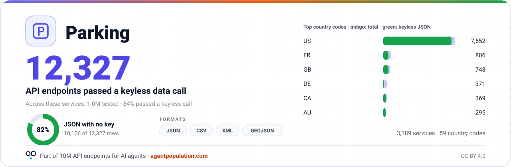
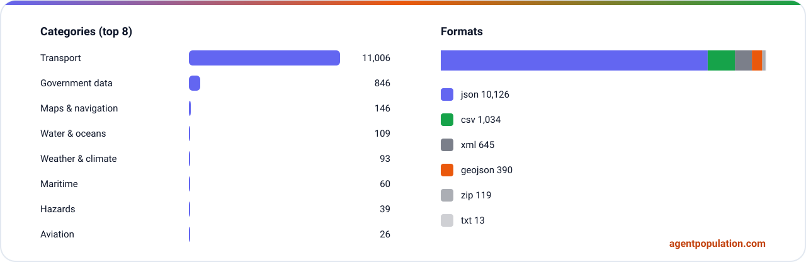

<p align="center"></p>

# 🅿️ Parking API endpoints

**12,327 parking API endpoints that answered a keyless GET with a data body. For agent and app builders.**

<p align="center"><a href="#files"></a> <a href="#columns-and-tags"></a> <a href="#whats-inside"></a> <a href="#whats-inside"></a> <a href="LICENSE"></a></p>

<p align="center"><a href="#whats-in-it-for-you">What's in it</a> · <a href="#for-ai-agents">For AI agents</a> · <a href="#quick-start">Quick start</a> · <a href="#test-it-yourself">Test it yourself</a> · <a href="#files">Files</a> · <a href="#licence-and-credit">Licence</a> · <a href="#part-of-10m-api-endpoints-for-ai-agents">More packs</a></p>

This repository holds a 1,000-row sample and the services list; the full list of 12,327 endpoints is one download from the [latest release](https://github.com/agentpopulation/12k-parking-apis-for-agents/releases/latest).

**Endpoints for building a parking finder.** Car park, garage and parking-lot layers, on-street zones and meters, occupancy feeds from car parks and street sensors, accessible and park-and-ride spaces, bike parking and parking-ticket records, as URLs that answered with no key on their test date.

Selection rule: rows where `tags has parking`, less the rows that a leave-out rule drops (each counted under Known limits).

10,586 of these 12,327 rows match the focus rule (below); the others are in the pack by the selection rule only, and Known limits says what they are. 7,017 rows (56.9%) are map layers on ArcGIS Online, where anyone can publish.

## In plain words

**What is an API endpoint?** An API endpoint is one web address that a program can ask for data, for example the latest reading at one weather station. A single service, such as a national weather agency, can have thousands of endpoints: one per station, city or dataset. This pack counts endpoints, not separate services.

**What does "passed a data call" mean?** On the date shown in each row, AgentPopulation sent one plain request to that address, with no password or key, and got a non-empty data body back (JSON, CSV, XML or a file): not an error page and not an empty result. Some bodies describe a dataset rather than hold its values; see Known limits. It shows the address answered with data on that day. It is not a promise that it answers today, and licences and usage limits were not reviewed.

## What's in it for you

Four ways to use this pack. Each bucket gives a count, a filter you can apply to the CSV, one example that passed, and a list of recommended starting points with the rule that picked them. Buckets overlap; a row can fit more than one.

Examples, recommended lists and the preview are drawn from rows that match this pack's focus rule, so a row that the selection rule put in this pack but that is about something else is not shown as a starting point. Counts cover the whole bucket.

<details>
<summary>The focus rule</summary>

Focus rule: `title matches /parking|parkings|parkplatz|parkplätz|parkhaus|parkhäus|parkhauser|parken|parkmöglich|parkeer|parkier|parkade|parklet|parkir|parkovi|car[ _-]?parks?|carpark|lorry[ _-]?parks?|truck[ _-]?parks?|bike[ _-]?parks?|park[ _]?(and|&|\+|n)[ _]?ride|stationnement|parcheggi|aparcamiento|estacionamiento|parqueadero|parqueo|garages?|parking meters?|parkingmeter|horodateur|pay (and|&) display|pay stations?|loading zones?|curb|kerb|bike[ _-]?racks?|cycle[ _-]?racks?|fietsenrek|blue badge|penalty charge|στάθμευσ|паркин/i AND NOT url contains "/DCGIS_DATA/Planimetrics_" AND NOT host is api.weather.gov AND NOT title matches /solar|photovolta/i AND NOT title matches /food[ _-]?trucks?/i AND NOT url matches /(^|[/_-])test[-_]|[-_]test(/|$)/i`

</details>

### 🤖 Agent tools: Car parks, parking zones and occupancy an agent can look up

**7,540** endpoints from 2,611 services · Wrap one URL pattern as a find_parking tool: pass a city or a point, return nearby car parks or zones with capacity, occupancy where the source gives it, and the time of the reading.

182 of these have an occupancy, sensor or availability term in the title; the others are layers of car parks, lots, zones and meters.

6,355 of these are map-layer queries that asked for a few records (`resultRecordCount`); raise it or page through for the whole layer.

Start with: `tags has agent-ready AND title matches /parking|parkings|parkplatz|parkplätz|parkhaus|parkhäus|parkhauser|parken|parkmöglich|parkeer|parkier|parkade|parklet|parkir|parkovi|car[ _-]?parks?|carpark|lorry[ _-]?parks?|truck[ _-]?parks?|bike[ _-]?parks?|park[ _]?(and|&|\+|n)[ _]?ride|stationnement|parcheggi|aparcamiento|estacionamiento|parqueadero|parqueo|garages?|parking meters?|parkingmeter|horodateur|pay (and|&) display|pay stations?|loading zones?|curb|kerb|bike[ _-]?racks?|cycle[ _-]?racks?|fietsenrek|blue badge|penalty charge|στάθμευσ|паркин/i AND NOT title matches /violation|citation|penalty charge|bußgeld|bussgeld|verwarn|parkverstö|amende|infraction|\bfine[sd]?\b/i AND NOT title matches /bike|bicycle|cycle|fahrrad|vélo|velo|fiets|bici|scooter|micromobil|trottinette|motorcycle|motos?\b|2[ -]roues|deux[ -]roues/i`

Example: [data.gouv.fr tabular API: Disponibilité dans les …](https://tabular-api.data.gouv.fr/api/resources/951a57d1-733e-4516-a4fe-0e48129345b7/data/?page_size=10) · tabular-api.data.gouv.fr · passed 2026-11-15

<details>
<summary>Recommended starting points: 8 services, picked by the stated criteria inside</summary>

**Recommended starting points.** Selected by stated criteria, not a ranking of quality: Services in this pack with the most endpoints that match this bucket and are tagged `agent-ready` (no key sent in the test call, JSON body, passed a data call). Ties go to the service with more country codes, then by name. Only services with at least one bucket row that matches the focus rule are listed, and the sample comes from those rows; the counts cover the whole bucket. The sample URL is the first row by URL sort after preferring, in this order: rows that match the bucket's sample preference when it has one, rows that return values rather than describe a dataset or a service (not ERDDAP /info/ pages, OGC GetCapabilities requests, bare OWS addresses, PxWeb tables, UN SDG series lists, Statistics Canada download pointers, WorldPop listings, GTFS validation reports, untitled rows or service root addresses), and agent-ready rows. Sample preference in this bucket: `title matches /occupan|occupation|belegung|bezetting|auslastung|sensor|availab|disponib|places libres|parkingspot|status/i`. Services named "ArcGIS organization" hold map layers from many owners and are added only when fewer than 5 other services match.

| Service (host) | Endpoints in bucket | In pack | Country codes in bucket | Formats in bucket | Sample URL that passed |
|---|---:|---:|---|---|---|
| tabular-api.data.gouv.fr | 64 | 75 | FR | json | [data.gouv.fr tabular API: Disponibilité…](https://tabular-api.data.gouv.fr/api/resources/951a57d1-733e-4516-a4fe-0e48129345b7/data/?page_size=10) (2026-11-15) |
| Surreycc (sccmaps.surreycc.gov.uk) | 61 | 61 | US | json | [Highways Team - Parking Restrictions Hi…](https://sccmaps.surreycc.gov.uk/webmaps/rest/services/Highways_Team/Parking_Restrictions_Historic_Elmbridge/MapServer/0/query?where=1%3D1&outFields=*&returnGeometry=false&resultRecordCount=5&f=json) (2026-11-15) |
| Upm (broker-yoda.dit.upm.es) | 57 | 57 | ES | json | [santander\_parking-byda-013](https://broker-yoda.dit.upm.es/ngsi-ld/v1/entities/urn:ngsi-ld:ParkingSpot:santander:parking-byda-013) (2026-11-12) |
| data.gov.au (data.melbourne.vic.gov.au) | 57 | 76 | AU | json | [On-street Car Parking Sensor Data - 2011](https://data.melbourne.vic.gov.au/api/explore/v2.1/catalog/datasets/on-street-car-parking-sensor-data-2011/records?limit=1) (2026-11-12) |
| Lombardia (www.dati.lombardia.it) | 48 | 131 | IT | json | [Municipality of Cremosano - Car parks](https://www.dati.lombardia.it/api/views/5pug-sich/rows.json?accessType=DOWNLOAD) (2026-11-14) |
| maps2.dcgis.dc.gov | 42 | 448 | US | json | [Parking Blockface](https://maps2.dcgis.dc.gov/DCGIS/rest/services/DCGIS_DATA/Transportation_Parking_WebMercator/MapServer/0/query?where=1%3D1&outFields=*&returnGeometry=false&resultRecordCount=5&f=json) (2026-11-14) |
| ep trafficservices (ArcGIS Online) (services3.arcgis.com) | 35 | 36 | GB | json | [Alive Disabled Parking Route](https://services3.arcgis.com/hHDQkgojj58wkwXq/arcgis/rest/services/Alive_Disabled_Parking_Route/FeatureServer/0/query?where=1%3D1&outFields=*&returnGeometry=false&resultRecordCount=5&f=json) (2026-11-14) |
| Nantesmetropole (data.nantesmetropole.fr) | 31 | 69 | FR | json | [Nantes Métropole: Disponibilités en tem…](https://data.nantesmetropole.fr/api/explore/v2.1/catalog/datasets/244400404_parcs-relais-nantes-metropole-disponibilites/exports/json) (2026-11-15) |

</details>

### 📱 App features: Car parks, on-street zones, meters and accessible bays for a parking map

**3,266** endpoints from 1,294 services · Draw car parks, garages, on-street zones, meters and accessible bays on a map, and show capacity, tariff or opening hours where the layer has them.

Start with: `title matches /car[ _-]?parks?|carpark|garage|parkhaus|parkhäus|parkhauser|\blots?\b|parking (lots?|spaces?|areas?|zones?|bays?|places?|facilit|structures?|garages?)|on[- ]street|meters?|horodateur|accessible|disabled|handicap|blue badge|\bpmr\b|park[ _]?(and|&|\+|n)[ _]?ride|stationnement|parcheggi|parkplatz|parkplätz|parkeer/i AND NOT title matches /violation|citation|penalty charge|bußgeld|bussgeld|verwarn|parkverstö|amende|infraction|\bfine[sd]?\b/i AND NOT title matches /bike|bicycle|cycle|fahrrad|vélo|velo|fiets|bici|scooter|micromobil|trottinette|motorcycle|motos?\b|2[ -]roues|deux[ -]roues/i`

Example: [Municipality of Cremosano - Car parks](https://www.dati.lombardia.it/api/views/5pug-sich/rows.json?accessType=DOWNLOAD) · Lombardia · passed 2026-11-14

<details>
<summary>Recommended starting points: 8 services, picked by the stated criteria inside</summary>

**Recommended starting points.** Selected by stated criteria, not a ranking of quality: Services in this pack with the most endpoints that match this bucket and passed a data call. Ties go to the service with more country codes, then by name. Only services with at least one bucket row that matches the focus rule are listed, and the sample comes from those rows; the counts cover the whole bucket. The sample URL is the first row by URL sort after preferring, in this order: rows that match the bucket's sample preference when it has one, rows that return values rather than describe a dataset or a service (not ERDDAP /info/ pages, OGC GetCapabilities requests, bare OWS addresses, PxWeb tables, UN SDG series lists, Statistics Canada download pointers, WorldPop listings, GTFS validation reports, untitled rows or service root addresses), and agent-ready rows. Sample preference in this bucket: `title matches /car[ _-]?parks?|garage|parkhaus|parking (lots?|spaces?|garages?)/i AND NOT title matches /charging|charge point|chargepoint|recharge|ladesäul|ladestation|laadpa|\bev\b|electric vehicle/i`. Services named "ArcGIS organization" hold map layers from many owners and are added only when fewer than 5 other services match.

| Service (host) | Endpoints in bucket | In pack | Country codes in bucket | Formats in bucket | Sample URL that passed |
|---|---:|---:|---|---|---|
| Lombardia (www.dati.lombardia.it) | 93 | 131 | IT | json, xml, csv | [Municipality of Cremosano - Car parks](https://www.dati.lombardia.it/api/views/5pug-sich/rows.json?accessType=DOWNLOAD) (2026-11-14) |
| data.gov.au (data.melbourne.vic.gov.au) | 52 | 76 | AU | json, csv, geojson, xml | [On-street Car Parking Meters with Locat…](https://data.melbourne.vic.gov.au/api/explore/v2.1/catalog/datasets/on-street-car-parking-meters-with-location/records?limit=1) (2026-11-12) |
| tabular-api.data.gouv.fr | 35 | 75 | FR | json | [data.gouv.fr tabular API: Stationnement…](https://tabular-api.data.gouv.fr/api/resources/0feeec83-bc78-4482-a042-1ac7bdc789f7/data/?page_size=10) (2026-11-15) |
| Grandlyon (data.grandlyon.com) | 31 | 44 | FR | csv, geojson, json | [Métropole de Lyon: Périmètre de secteur…](https://data.grandlyon.com/geoserver/metropole-de-lyon/ows?SERVICE=WFS&VERSION=2.0.0&request=GetFeature&typename=metropole-de-lyon:plu_h_opposable.plustatio&outputFormat=application/json&SRSNAME=EPSG:4326) (2026-11-15) |
| Nantesmetropole (data.nantesmetropole.fr) | 30 | 69 | FR | json, csv, geojson | [Nantes Métropole: Emplacements gratuits…](https://data.nantesmetropole.fr/api/explore/v2.1/catalog/datasets/244400404_emplacements-gratuits-materialises-nantes-metropole/exports/geojson) (2026-11-15) |
| opendata.schleswig-holstein.de | 29 | 37 | DE | csv, json | [Car park Scharbeutz Badeweg](https://opendata.schleswig-holstein.de/dataset/46ce6d39-689e-4547-9f4e-914205000d63/resource/aae85dce-9341-4337-bdf2-91895cee9ffa/download/parkplatz-scharbeutz-badeweg-2023.json) (2026-11-14) |
| Anglet Opendatapaysbasque (Opendatasoft) (anglet-opendatapaysbasque.opendatasoft.com) | 28 | 35 | FR | json, csv, geojson | [Commune d'Anglet: Places de stationneme…](https://anglet-opendatapaysbasque.opendatasoft.com/api/explore/v2.1/catalog/datasets/localisation-des-places-de-stationnement-arret-minute-sur-la-commune-d-anglet/exports/json) (2026-11-15) |
| Emel (dados.emel.pt) | 27 | 27 | PT | json, csv, xml | [EMEL: Estatísticas do número de lugares…](https://dados.emel.pt/api/3/action/datastore_search?resource_id=4f275433-efbc-4ce7-8d76-77003f9aa271) (2026-11-15) |

</details>

### 🧠 Grounding and data pipelines: Occupancy series, car-park tables and parking tickets for scheduled loads

**2,536** endpoints from 334 services · Load car-park tables, occupancy history and parking-ticket records on a schedule into your own store, so answers about parking supply and demand cite a dated source.

724 of these are parking tickets, citations or fines (enforcement records); the others are files of car parks, zones and occupancy.

Start with: `(format in (csv, xml, zip, txt, geojson) OR title matches /violation|citation|penalty charge|bußgeld|bussgeld|verwarn|parkverstö|amende|infraction|\bfine[sd]?\b/i) AND NOT title matches /bike|bicycle|cycle|fahrrad|vélo|velo|fiets|bici|scooter|micromobil|trottinette|motorcycle|motos?\b|2[ -]roues|deux[ -]roues/i`

Example: [Municipality of Cremosano - Car parks](https://www.dati.lombardia.it/api/views/5pug-sich/rows.csv?accessType=DOWNLOAD) · Lombardia · passed 2026-11-14

<details>
<summary>Recommended starting points: 8 services, picked by the stated criteria inside</summary>

**Recommended starting points.** Selected by stated criteria, not a ranking of quality: Services in this pack with the most endpoints that match this bucket and passed a data call. Ties go to the service with more country codes, then by name. Only services with at least one bucket row that matches the focus rule are listed, and the sample comes from those rows; the counts cover the whole bucket. The sample URL is the first row by URL sort after preferring, in this order: rows that match the bucket's sample preference when it has one, rows that return values rather than describe a dataset or a service (not ERDDAP /info/ pages, OGC GetCapabilities requests, bare OWS addresses, PxWeb tables, UN SDG series lists, Statistics Canada download pointers, WorldPop listings, GTFS validation reports, untitled rows or service root addresses), and agent-ready rows. Sample preference in this bucket: `title matches /occupan|occupation|belegung|bezetting|auslastung|sensor|availab|disponib|places libres|parkingspot|status|car[ _-]?parks?|parkhaus/i`. Services named "ArcGIS organization" hold map layers from many owners and are added only when fewer than 5 other services match.

| Service (host) | Endpoints in bucket | In pack | Country codes in bucket | Formats in bucket | Sample URL that passed |
|---|---:|---:|---|---|---|
| maps2.dcgis.dc.gov | 330 | 448 | US | json | [Parking Violations Summary for 2010 - W…](https://maps2.dcgis.dc.gov/dcgis/rest/services/DCGIS_DATA/ViolationsSummary/MapServer/1/query?where=1%3D1&outFields=*&returnGeometry=false&resultRecordCount=5&f=json) (2026-11-14) |
| opendata.dc.gov | 190 | 191 | US | csv, xml, json | [Parking Violations Issued in March 2025…](https://opendata.dc.gov/api/download/v1/items/05fb8f671d564f188c0b10a8de4e55c8/geojson?layers=2) (2026-11-15) |
| Lombardia (www.dati.lombardia.it) | 83 | 131 | IT | xml, csv | [Municipality of Cremosano - Car parks](https://www.dati.lombardia.it/api/views/5pug-sich/rows.csv?accessType=DOWNLOAD) (2026-11-14) |
| datamillnorth.org | 69 | 71 | GB | csv | [Car Parking Claims - 2018 - 2019](https://datamillnorth.org/download/e61xw/5ff39847-fdf0-407e-b825-715f6643df60/LCC%20Car%20Parking%20Claims.csv) (2026-11-15) |
| data.gov.rs | 65 | 69 | RS | csv, geojson, zip | [Град Зрењанин: Паркинг / crvena-zona-20…](https://data.gov.rs/s/resources/parking-1/20220115-025247/crvena-zona-2019-08-10-2019.csv) (2026-11-15) |
| NYC Open Data (Socrata) (data.cityofnewyork.us) | 53 | 81 | US | xml, csv, json, zip | [Parking Violations Issued - Fiscal Year…](https://data.cityofnewyork.us/api/views/2bnn-yakx/rows.json?accessType=DOWNLOAD) (2026-11-15) |
| Transparenzportal Hamburg (archiv.transparenz.hamburg.de) | 45 | 45 | DE | xml | [Hamburg car parks](https://archiv.transparenz.hamburg.de/hmbtgarchive/HMDK/wms_parkhaeuser_223739_snap_2.XML) (2026-11-14) |
| Портал відкритих даних (data.gov.ua) | 40 | 45 | UA | csv, zip | [data.gov.ua: The list of concluded agre…](https://data.gov.ua/dataset/09ef1014-0584-4de2-af68-e03813b24a22/resource/1d7261c3-b1d1-4e52-b7c2-02d341cc7445/download/ukladeni-dogovori-za-4-i-kvartal-2020.csv) (2026-11-15) |

</details>

### 🧪 Evals and testing: Occupancy feeds, map layers and files to test a parking tool

**12,327** endpoints · 3,189 services · 59 country codes · 6 formats · Run your parking tool against a fixed set of URLs across formats; check that name, location, capacity, occupancy and time parse, and keep last_tested as the baseline for your own re-tests.

Start with: the whole pack

Example: [Parking Blockface - Parking Zones](https://maps2.dcgis.dc.gov/DCGIS/rest/services/DCGIS_DATA/Transportation_Parking_WebMercator/MapServer/156/query?where=1%3D1&outFields=*&returnGeometry=false&resultRecordCount=5&f=json) · maps2.dcgis.dc.gov · passed 2026-11-15

<details>
<summary>Recommended starting points: 8 services, picked by the stated criteria inside</summary>

**Recommended starting points.** Selected by stated criteria, not a ranking of quality: Services in this pack that returned the most different formats, then the most endpoints that passed a data call, then by name: a mix of response shapes to test parsers and tool calls. Only services with at least one bucket row that matches the focus rule are listed, and the sample comes from those rows; the counts cover the whole bucket. The sample URL is the first row by URL sort after preferring, in this order: rows that match the bucket's sample preference when it has one, rows that return values rather than describe a dataset or a service (not ERDDAP /info/ pages, OGC GetCapabilities requests, bare OWS addresses, PxWeb tables, UN SDG series lists, Statistics Canada download pointers, WorldPop listings, GTFS validation reports, untitled rows or service root addresses), and agent-ready rows. Sample preference in this bucket: `title matches /car[ _-]?parks?|carpark|garage|parkhaus|parkhäus|parkhauser|\blots?\b|parking (lots?|spaces?|areas?|zones?|bays?|places?|facilit|structures?|garages?)|on[- ]street|meters?|horodateur|accessible|disabled|handicap|blue badge|\bpmr\b|park[ _]?(and|&|\+|n)[ _]?ride|stationnement|parcheggi|parkplatz|parkplätz|parkeer/i AND NOT title matches /bike|bicycle|cycle|fahrrad|vélo|velo|fiets|bici|scooter|micromobil|trottinette|motorcycle|motos?\b|2[ -]roues|deux[ -]roues/i`. Services named "ArcGIS organization" hold map layers from many owners and are added only when fewer than 5 other services match.

| Service (host) | Endpoints in bucket | In pack | Country codes in bucket | Formats in bucket | Sample URL that passed |
|---|---:|---:|---|---|---|
| Dublinked Open Data for the Dublin Regio (data.smartdublin.ie) | 41 | 41 | IE | csv, json, geojson, xml, zip | [Parking Meters, Signs & Runs DLR](https://data.smartdublin.ie/dataset/41660b5a-e0f2-4694-af90-e6a53a1ecbc2/resource/ceb06bc9-bc1b-44dd-b8df-ba39f7e022b6/download/dlr_parking_run.geojson) (2026-11-14) |
| daten.stadt.sg.ch | 25 | 25 | CH | xml, json, csv, txt, geojson | [freie-parkplatze-in-der-stadt-stgallen-…](https://daten.stadt.sg.ch/api/explore/v2.1/catalog/datasets/freie-parkplatze-in-der-stadt-stgallen-pls/records?limit=1) (2026-11-12) |
| ArcGIS Online: Louisville Metro KY (louisville-metro-opendata-lojic.hub.arcgis.com) | 6 | 6 | US | csv, geojson, json, xml, zip | [Louisville Metro KY - Parking Meter Inv…](https://louisville-metro-opendata-lojic.hub.arcgis.com/api/download/v1/items/7cb18137f9b5485b87f31acf84193990/geojson?layers=0) (2026-11-15) |
| NYC Open Data (Socrata) (data.cityofnewyork.us) | 81 | 81 | US | json, xml, csv, zip | [Temporary Parking Permit for People wit…](https://data.cityofnewyork.us/api/views/gxhb-59kq/rows.json?accessType=DOWNLOAD) (2026-11-15) |
| data.gov.au (data.melbourne.vic.gov.au) | 76 | 76 | AU | json, csv, geojson, xml | [On-street Car Parking Meters with Locat…](https://data.melbourne.vic.gov.au/api/explore/v2.1/catalog/datasets/on-street-car-parking-meters-with-location/records?limit=1) (2026-11-12) |
| data.gov.rs | 69 | 69 | RS | csv, geojson, zip, json | [Град Ниш: Паркинг / Паркинг места - пол…](https://data.gov.rs/s/resources/parking/20210421-004809/parkingmesta-poligoni.geojson) (2026-11-15) |
| Cityofchicago (data.cityofchicago.org) | 41 | 41 | US | xml, json, csv, zip | [CTA - Park & Ride Locations- kml - KMZ …](https://data.cityofchicago.org/download/2cys-9ux7/application/vnd.google-earth.kmz) (2026-11-15) |
| Lacity (data.lacity.org) | 38 | 38 | US | json, xml, csv, zip | [Los Angeles International Airport (LAX)…](https://data.lacity.org/api/views/dik5-hwp6/rows.json?accessType=DOWNLOAD) (2026-11-15) |

</details>

The same lists are in [recommended.json](recommended.json), ready for an agent to load.

## Questions an agent can answer with this pack

- Is a given on-street parking spot in Santander occupied or vacant? Try [santander\_parking-byda-013](https://broker-yoda.dit.upm.es/ngsi-ld/v1/entities/urn:ngsi-ld:ParkingSpot:santander:parking-byda-013) (Upm, passed 2026-11-12).
- What occupancy level do the Liverpool (New South Wales) car parks report? Try [Parking Occupancy Level](https://data.liverpool.nsw.gov.au/api/explore/v2.1/catalog/datasets/parking-occupancy-data-realtime/records?limit=1) (Nsw, passed 2026-11-12).
- Which parking violations did New York City issue in a fiscal year? Try [Parking Violations Issued - Fiscal Year 2017](https://data.cityofnewyork.us/resource/2bnn-yakx.json?$limit=1) (Cuny, passed 2026-11-11).

## What "passed a data call" means

> [!NOTE]
> On the date in `last_tested` (IST), one GET to the URL, sent with no key, returned HTTP 2xx and a non-empty data body. HTML pages and empty results did not pass. The `format` column records what came back. This is a test result for that date, not a promise that the URL answers today. Licences, terms, rate limits, accuracy and freshness were not reviewed. Endpoints are URLs, not separate APIs; many share one service. This pack was tested 11–15 Nov 2026; snapshot 15 Nov 2026.

## For AI agents

Start from keyless JSON endpoints (`agent-ready`). The code below loads `recommended.json` and calls the first recommended service in the Agent tools bucket, with a timeout (`node examples/agent-start.mjs --recommended`). With no argument, `node examples/agent-start.mjs` calls the most recently tested agent-ready row of the sample; pass a `.csv` or `.csv.gz` path to use that file instead. See [examples/agent-start.mjs](examples/agent-start.mjs).

```js
// Node 18+. Loads recommended.json (the local copy, or the raw file on GitHub) and calls one keyless JSON endpoint.
import fs from 'node:fs';

const RAW = 'https://raw.githubusercontent.com/agentpopulation/12k-parking-apis-for-agents/main/recommended.json';
const rec = fs.existsSync('recommended.json')
  ? JSON.parse(fs.readFileSync('recommended.json', 'utf8'))
  : await (await fetch(RAW)).json();

const pick = rec.buckets.find((b) => b.id === 'agent').services[0];
try {
  const res = await fetch(pick.sample_url, {
    headers: { 'User-Agent': 'agent-example/1.0' },
    signal: AbortSignal.timeout(15000),
  });
  console.log(pick.service, res.status, res.headers.get('content-type'));
  console.log((await res.text()).slice(0, 300));
} catch (err) {
  console.log(`did not answer now; last passed ${pick.sample_last_tested} (${err.message})`);
}
```

How an agent picks an endpoint:

1. Filter to `agent-ready` and your country or topic.
2. Prefer the newest `last_tested` and the larger services.
3. Call with a timeout and check the body before you use it.

## Quick start

The examples run against the sample in `data/` out of the box (1,000 rows). Each takes an optional path to a `.csv` or `.csv.gz` file instead.

```bash
git clone https://github.com/agentpopulation/12k-parking-apis-for-agents.git
cd 12k-parking-apis-for-agents
python examples/quickstart.py
node examples/quickstart.mjs
node examples/agent-start.mjs
```

Full list: download `Parking_API_Endpoints_AgentPopulation_Snapshot_2026-11-15.csv.gz` (12,327 rows, 674.3 kB) from [releases/latest](https://github.com/agentpopulation/12k-parking-apis-for-agents/releases/latest), then gunzip it and pass its path. The scripts also read the `.csv.gz` as it is.

```bash
gunzip Parking_API_Endpoints_AgentPopulation_Snapshot_2026-11-15.csv.gz
python examples/quickstart.py Parking_API_Endpoints_AgentPopulation_Snapshot_2026-11-15.csv
node examples/quickstart.mjs Parking_API_Endpoints_AgentPopulation_Snapshot_2026-11-15.csv
```

### curl

Quote the URL: some contain commas.

```bash
curl -sL "https://raw.githubusercontent.com/agentpopulation/12k-parking-apis-for-agents/main/data/Parking_API_Endpoints_AgentPopulation_Sample.csv" | head -n 4
curl -s --max-time 15 "https://tabular-api.data.gouv.fr/api/resources/951a57d1-733e-4516-a4fe-0e48129345b7/data/?page_size=10" | head -c 600
```

### Python

Standard library only: [examples/quickstart.py](examples/quickstart.py) reads the sample, or the path you pass, keeps agent-ready rows and calls the most recently tested one.

<details>
<summary>The code</summary>

```python
# Python 3, standard library only. Run from a clone of this repository:
#   python examples/quickstart.py [path]
# With no path it reads the sample in data/. Pass the full list from the latest release (.csv or .csv.gz) instead.
# Keeps agent-ready rows and calls the most recently tested one.
import csv
import gzip
import os
import re
import sys
import urllib.request

HERE = os.path.dirname(os.path.abspath(__file__))
path = sys.argv[1] if len(sys.argv) > 1 else os.path.join(HERE, "..", "data", "Parking_API_Endpoints_AgentPopulation_Sample.csv")
opener = gzip.open if path.endswith(".gz") else open
with opener(path, "rt", newline="", encoding="utf-8") as f:
    rows = list(csv.DictReader(f))

agent = [r for r in rows if "agent-ready" in r["tags"].split("|")]
# Newest test date first; URLs that describe a dataset or a service rather than return values go last.
DESCRIBES = re.compile(r"/erddap/info/|action-report\.json$|[?&]request=getcapabilities|/GeoArea/[^/?]+/List|getFullTableDownloadCSV|hub\.worldpop\.org", re.I)
agent.sort(key=lambda r: r["last_tested"], reverse=True)
agent.sort(key=lambda r: 1 if DESCRIBES.search(r["url"]) else 0)
print(len(rows), "rows,", len(agent), "agent-ready")
if not agent:
    sys.exit(0)

row = agent[0]
req = urllib.request.Request(row["url"], headers={"User-Agent": "agent-example/1.0"})
try:
    with urllib.request.urlopen(req, timeout=15) as res:
        body = res.read(1_000_000).decode("utf-8", "replace")
        print(res.status, res.headers.get("Content-Type"))
        print(body[:300])
except Exception as err:
    print(f"did not answer now; last passed {row['last_tested']} ({err})")
```

</details>

### JavaScript

Reads the sample as JSON because the CSV has quoted commas.

<details>
<summary>The code</summary>

```js
// Node 18+. Reads the sample as JSON (the CSV has quoted commas), local file first.
import fs from 'node:fs';

const FILE = 'data/Parking_API_Endpoints_AgentPopulation_Sample.json';
const rows = fs.existsSync(FILE)
  ? JSON.parse(fs.readFileSync(FILE, 'utf8'))
  : await (await fetch('https://raw.githubusercontent.com/agentpopulation/12k-parking-apis-for-agents/main/data/Parking_API_Endpoints_AgentPopulation_Sample.json')).json();

const row = rows.find((r) => r.tags.includes('agent-ready'));
const res = await fetch(row.url, { headers: { 'User-Agent': 'agent-example/1.0' }, signal: AbortSignal.timeout(15000) });
console.log(res.status, (await res.text()).slice(0, 300));
```

</details>

### Agent tools

[examples/agent-tools.json](examples/agent-tools.json) holds two tool definitions in the shape most tool-calling APIs accept (name, description, JSON Schema); rename `parameters` if yours uses another key. [examples/quickstart.mjs](examples/quickstart.mjs) implements them:

- `find_endpoints` searches the agent-ready rows of the list by words, country code (their format is json). When you load the tools of more than one pack, prefix the names (for example `parking_find_endpoints`) so they do not clash.
- `fetch_endpoint` calls one URL, **refuses any URL that is not in the list** and does not follow redirects. The allowlist is built from the CSV, so a URL injected into a prompt is refused.

The same two tools can sit behind an MCP server.

## Test it yourself

Re-test endpoints from the sample with the same rule: HTTP 2xx and a non-empty body that is not an HTML page. Node 18+, no packages.

```bash
node tools/test-endpoints.mjs
```

It tests the first 50 URLs and prints one line: tested, passed, did not pass. Options: a `.csv` or `.csv.gz` path (the full list from the release), `--limit 50`, `--timeout-ms 10000`, `--out results.csv`. The results file holds `url`, `status`, `passed`, `content_type`, `ms` and `checked_at`; a status of `timeout` or `error:<code>` means no HTTP answer came back. It is polite: GET only, no key sent, at most 4 requests in flight, one at a time per listed host, at least 1 second between requests to one listed host, and reading stops once 256 kB of a body is kept. Redirects are followed and may lead to another host. `results.csv` is in `.gitignore`.

## Preview

One row from each of the five largest services among rows that match the focus rule, services with rows that return values first.

| Title | Service | Country | Format | Tested | Link |
|---|---|---|---|---|---|
| Parking Blockface | maps2.dcgis.dc.gov | US | json | 2026-11-14 | [maps2.dcgis.dc.gov](https://maps2.dcgis.dc.gov/DCGIS/rest/services/DCGIS_DATA/Transportation_Parking_WebMercator/MapServer/0/query?where=1%3D1&outFields=*&returnGeometry=false&resultRecordCount=5&f=json) |
| Bicycle Parking gl348 | University of Exeter (ArcGIS Online) | GB | json | 2026-11-15 | [services5.arcgis.com](https://services5.arcgis.com/N6Nhpnxaedla81he/arcgis/rest/services/Bicycle_Parking_gl348/FeatureServer/0/query?where=1%3D1&outFields=*&returnGeometry=false&resultRecordCount=5&f=json) |
| Municipality of Cremosano - Car parks | Lombardia | IT | json | 2026-11-14 | [www.dati.lombardia.it](https://www.dati.lombardia.it/api/views/5pug-sich/rows.json?accessType=DOWNLOAD) |
| Parking Violations Issued in March 2025 - GeoJSON | opendata.dc.gov | US | json | 2026-11-15 | [opendata.dc.gov](https://opendata.dc.gov/api/download/v1/items/05fb8f671d564f188c0b10a8de4e55c8/geojson?layers=2) |
| ABM\_Parking\_Zones | ArcGIS Online layers (services3.arcgis.com, org ExKzFjtGCmTXLlFV) | US | json | 2026-11-14 | [services3.arcgis.com](https://services3.arcgis.com/ExKzFjtGCmTXLlFV/arcgis/rest/services/ABM_Parking_Zones/FeatureServer/0/query?where=1%3D1&outFields=*&returnGeometry=false&resultRecordCount=5&f=json) |

Browse the 1,000-row sample: [Sample CSV](data/Parking_API_Endpoints_AgentPopulation_Sample.csv) · [Sample JSON](data/Parking_API_Endpoints_AgentPopulation_Sample.json).

## What's inside

<p align="center"></p>

<details>
<summary>Country codes: 59</summary>

| Code | Country | Endpoints | |
|---|---|---:|---|
| US | United States | 7,552 | `████████████████████` |
| FR | France | 806 | `██▏` |
| GB | United Kingdom | 743 | `██` |
| DE | Germany | 371 | `█` |
| CA | Canada | 369 | `█` |
| AU | Australia | 295 | `▊` |
| IT | Italy | 237 | `▋` |
| BE | Belgium | 171 | `▌` |
| CH | Switzerland | 166 | `▌` |
| IE | Ireland | 126 | `▍` |
| | other 49 codes | 1,001 | |
| | global or unknown | 490 | `█▎` |

</details>

<details>
<summary>Categories: top 8</summary>

| Category | Endpoints | |
|---|---:|---|
| Transport & Mobility | 11,006 | `████████████████████` |
| Government & Open Data | 846 | `█▌` |
| Navigation & Geo/Maps | 146 | `▎` |
| Hydrology & Oceans | 109 | `▎` |
| Weather & Climate | 93 | `▏` |
| Maritime | 60 | `▏` |
| Hazards | 39 | `▏` |
| Aviation | 26 | `▏` |

</details>

Formats: json 10,126 · csv 1,034 · xml 645 · geojson 390 · zip 119 · txt 13

<details>
<summary>Largest services: top 25 of 3,189</summary>

| Service | Host | Endpoints | Keyless JSON | |
|---|---|---:|---:|---|
| maps2.dcgis.dc.gov | maps2.dcgis.dc.gov | 448 | 448 | `████████████████████` |
| University of Exeter (ArcGIS Online) | services5.arcgis.com | 221 | 221 | `█████████▉` |
| opendata.dc.gov | opendata.dc.gov | 191 | 63 | `████████▌` |
| Lombardia | www.dati.lombardia.it | 131 | 48 | `█████▉` |
| ArcGIS Online layers (services3.arcgis.com, org ExKzFjtGCmTXLlFV) | services3.arcgis.com | 92 | 92 | `████▏` |
| NYC Open Data (Socrata) | data.cityofnewyork.us | 81 | 40 | `███▋` |
| data.gov.au | data.melbourne.vic.gov.au | 76 | 59 | `███▍` |
| tabular-api.data.gouv.fr | tabular-api.data.gouv.fr | 75 | 75 | `███▍` |
| datamillnorth.org | datamillnorth.org | 71 | 0 | `███▏` |
| Nantesmetropole | data.nantesmetropole.fr | 69 | 34 | `███▏` |
| data.gov.rs | data.gov.rs | 69 | 3 | `███▏` |
| Surreycc | sccmaps.surreycc.gov.uk | 61 | 61 | `██▊` |
| vector.sitg.ge.ch | vector.sitg.ge.ch | 57 | 29 | `██▌` |
| Upm | broker-yoda.dit.upm.es | 57 | 57 | `██▌` |
| Texas Tech University (ArcGIS Online) | services2.arcgis.com | 56 | 56 | `██▌` |
| Saemes | opendata.saemes.fr | 52 | 28 | `██▍` |
| ArcGIS Online layers (services6.arcgis.com, org HUP9nOAGSEOUUsmE) | services6.arcgis.com | 45 | 45 | `██` |
| Transparenzportal Hamburg | archiv.transparenz.hamburg.de | 45 | 0 | `██` |
| Портал відкритих даних | data.gov.ua | 45 | 5 | `██` |
| Grandlyon | data.grandlyon.com | 44 | 5 | `██` |
| Cityofchicago | data.cityofchicago.org | 41 | 14 | `█▉` |
| Dublinked Open Data for the Dublin Regio | data.smartdublin.ie | 41 | 8 | `█▉` |
| Lacity | data.lacity.org | 38 | 16 | `█▊` |
| opendata.schleswig-holstein.de | opendata.schleswig-holstein.de | 37 | 9 | `█▋` |
| ep trafficservices (ArcGIS Online) | services3.arcgis.com | 36 | 36 | `█▋` |

</details>

<details>
<summary>Rows per test date: 11–15 Nov 2026</summary>

| Date (IST) | Endpoints | |
|---|---:|---|
| 2026-11-15 | 5,251 | `████████████████▋` |
| 2026-11-14 | 6,294 | `████████████████████` |
| 2026-11-13 | 28 | `▏` |
| 2026-11-12 | 474 | `█▌` |
| 2026-11-11 | 280 | `▉` |

</details>

## Files

| File | Rows | Size | Use |
|---|---:|---:|---|
| [data/Parking_API_Services_AgentPopulation.csv](data/Parking_API_Services_AgentPopulation.csv) | 3,189 | 190.0 kB | One row per service with its endpoint count in this pack |
| [data/Parking_API_Endpoints_AgentPopulation_Sample.csv](data/Parking_API_Endpoints_AgentPopulation_Sample.csv) | 1,000 | 331.0 kB | The sample: focus-rule rows first, each service in proportion to its share; ArcGIS Online layers count as one service |
| [data/Parking_API_Endpoints_AgentPopulation_Sample.json](data/Parking_API_Endpoints_AgentPopulation_Sample.json) | 1,000 | 531.5 kB | The same rows as JSON, tags as an array |
| [Parking_API_Endpoints_AgentPopulation_Snapshot_2026-11-15.csv.gz](https://github.com/agentpopulation/12k-parking-apis-for-agents/releases/latest) | 12,327 | 674.3 kB | The full list, gzipped CSV: a download from the latest release, checked by `SHA256SUMS.txt` |
| [tools/test-endpoints.mjs](tools/test-endpoints.mjs) | | | Re-tests endpoints from the sample or the full list |

Sample size: 1,000 rows, which is 1,000 or one third of the pack rounded down, whichever is smaller. Rows that match the focus rule come first. Each service gets rows in proportion to its share of those rows, at least one for the largest services and at most 50% of the sample while other services have rows; ArcGIS Online layers count as one service, whatever their organisation. Within a service, agent-ready rows, rows that return values and the newest test dates come first, and rows are written in turn across services. Service root addresses are placed at the end of the sample.

Full list: download `Parking_API_Endpoints_AgentPopulation_Snapshot_2026-11-15.csv.gz` (12,327 rows, 674.3 kB) from [releases/latest](https://github.com/agentpopulation/12k-parking-apis-for-agents/releases/latest), then gunzip it and pass its path. The scripts also read the `.csv.gz` as it is.

Excel users: Data > From Text/CSV, UTF-8. Files are UTF-8 without a byte-order mark and comma-separated.

## Columns and tags

<details>
<summary>Columns, types and tags</summary>

| Column | Type | Example | Meaning |
|---|---|---|---|
| url | string | [https://maps2.dcgis.dc.gov/DCGIS/rest/s…](https://maps2.dcgis.dc.gov/DCGIS/rest/services/DCGIS_DATA/Transportation_Parking_WebMercator/MapServer/0/query?where=1%3D1&outFields=*&returnGeometry=false&resultRecordCount=5&f=json) | The address that was tested |
| title | string | Parking Blockface | Station, dataset or feed name |
| service | string | maps2.dcgis.dc.gov | The service the endpoint belongs to; joins to the services file together with host |
| host | string | maps2.dcgis.dc.gov | Host name of the address |
| country | string | US | ISO 3166-1 alpha-2 code, or EU; empty when global or unknown |
| category | string | Transport & Mobility | Category of the endpoint |
| subcategory | string |  | Left empty from the 15 Nov 2026 snapshot; kept so the columns stay the same |
| format | string | json | What the test call returned: json, csv, geojson, xml, gtfs, zip, txt and so on |
| tags | string | `transit\|parking\|maps\|no-key\|json\|agent-…` | Tags separated by \| |
| last_tested | date | 2026-11-14 | Date of the test call, YYYY-MM-DD (IST) |

| Tag | Rows | Meaning |
|---|---:|---|
| no-key | 12,327 | No key was sent in the test call |
| parking | 12,327 | Topic tag |
| transit | 11,073 | Topic tag |
| agent-ready | 10,126 | No key sent, JSON body, passed a data call on last_tested |
| json | 10,126 | Format of the body |
| maps | 9,520 | Topic tag |
| open-data | 2,756 | Topic tag |
| government | 1,199 | Topic tag |
| csv | 1,034 | Format of the body |
| xml | 645 | Format of the body |
| geojson | 390 | Format of the body |
| traffic | 121 | Topic tag |
| water | 109 | Topic tag |
| weather | 102 | Topic tag |
| maritime | 64 | Topic tag |
| statistics | 64 | Topic tag |
| rivers | 45 | Topic tag |
| hazards | 41 | Topic tag |
| aviation | 36 | Topic tag |
| environment | 15 | Topic tag |
| elevation | 12 | Topic tag |
| finance | 10 | Topic tag |
| health | 10 | Topic tag |
| energy | 9 | Topic tag |
| floods | 7 | Topic tag |
| science | 7 | Topic tag |
| forecast | 5 | Topic tag |
| oceans | 5 | Topic tag |
| bike-share | 3 | Topic tag |
| economy | 3 | Topic tag |
| geocoding | 3 | Topic tag |
| groundwater | 2 | Topic tag |
| tides | 2 | Topic tag |
| air-quality | 1 | Topic tag |
| speech | 1 | Topic tag |
| volcanoes | 1 | Topic tag |

A machine-readable copy of this dictionary is in [datapackage.json](datapackage.json).

</details>

## Known limits

- 61.3% of rows carry country code US; 490 rows have no code (global or unknown).
- 16 rows come from PxWeb or Statistics Canada services. Some statistics endpoints return metadata or a pointer on GET; the table may need a second request or a POST.
- 8,619 rows are map-layer queries with resultRecordCount set: the tested call asked for a few records; change the query to get the full layer.
- 427 rows carry limit=1: the tested call asked for one record; raise the limit or page through.
- 782 rows are open-data portal dataset records, which may return a dataset record with links rather than the table itself.
- 132 rows are files (zip 119, txt 13) rather than bodies an agent reads directly.
- 4 rows are service root addresses (the host alone or an API or version path such as /v1, with no query), which may describe the service rather than return data; the sample, examples and recommended lists use other rows first.
- 7,017 rows are layers on ArcGIS Online, where anyone can publish: some are class projects, tests or copies. Check the owner and the fields before you rely on one.
- 1,701 rows carry the parking tag but have no parking term in the title; many are layers of parks, trails, streets, polling places or city property. Check the title before you use one; they are not used as starting points.
- 57 rows are Washington DC planimetric layers by year (swimming pools, sidewalks, wooded areas, parking lots and more) filed under the parking tag; only some are about parking.
- 724 rows are parking tickets, citations or fines (Washington DC monthly layers, New York City fiscal years and others): enforcement records, not places to park.
- 1,092 rows are bicycle, scooter or motorcycle parking.
- 19 rows are solar-potential or solar-panel layers (some list parking as one kind of surface), not parking data.
- 27 rows are about electric-vehicle charging points, some at car parks.
- 24 rows have a dataset id marked as a test; they are not used as starting points.
- 57 rows are single on-street parking spots in Santander, Spain, one address per spot.
- Many map layers carry no country code, and some carry one that does not match the place in their title (layers from Malaysia or Quebec coded US); check the title or the host when you filter by country.
- Stations and feeds can go quiet after their test date; re-test a URL before you rely on it.
- Not in this pack: endpoints that need a key or a POST, and URLs that did not pass.
- Left out: 177 ArcGIS Survey123 layers (they can hold people's form answers).
- Left out: 2 layers marked editable in the title (they can hold entries that people added).
- Left out: 21 ArcGIS layers that keep a form's default service name (they can hold people's form answers).
- Left out: 98 ArcGIS class or coursework layers (lab, assignment, exam, quiz, lesson, exercise, tutorial and final-project layers, copies of class layers, layers named for a person or a person's home, and layers whose name ends in a person's name or holds a student number).
- Left out: 19 ArcGIS layers that hold reports, comments, submissions or form responses sent in by the public.
- Left out: 7 rows of server information from Mastodon, PeerTube, Lemmy, Nostr and other social network servers (instance documents name the server's contact person).

## Licence and credit

> [!IMPORTANT]
> This list (URLs, titles, tags and test results) is © 2026 AgentPopulation, released under [CC BY 4.0](https://creativecommons.org/licenses/by/4.0/). Credit AgentPopulation and link agentpopulation.com. The data each endpoint returns belongs to its provider and stays under that provider's terms; this licence does not cover it.

Copy-ready credit:

`Parking API endpoints by AgentPopulation (https://agentpopulation.com), CC BY 4.0, snapshot 15 Nov 2026.`

GitHub's "Cite this repository" button reads [CITATION.cff](CITATION.cff).

<!-- agentpopulation:start -->
## Part of 10M API endpoints for AI agents

This pack is one of the 24 topic packs of [10m-open-apis-for-ai-agents](https://github.com/agentpopulation/10m-open-apis-for-ai-agents), the open collection by [AgentPopulation](https://agentpopulation.com). Target: 10 million+ open API endpoints that pass a keyless API call.

AgentPopulation has tested over 5 million API endpoints: 5,129,834 tested, 3,726,509 passed a data call (snapshot 15 Nov 2026). This is the parking pack: 12,327 endpoints from 3,189 services. Packs overlap, so an endpoint can appear in more than one.

For the latest tested endpoints, search [agentpopulation.com/apis](https://agentpopulation.com/apis). This pack is a snapshot from 15 Nov 2026.

Sibling packs that share the most URLs with this one: [270k-transit-apis-for-agents](https://github.com/agentpopulation/270k-transit-apis-for-agents) (12,327 shared) · [2.5m-agent-ready-apis](https://github.com/agentpopulation/2.5m-agent-ready-apis) (10,126 shared) · [1.3m-government-open-data-apis](https://github.com/agentpopulation/1.3m-government-open-data-apis) (846 shared) · [380k-maps-gis-apis-for-agents](https://github.com/agentpopulation/380k-maps-gis-apis-for-agents) (146 shared) · [24k-traffic-apis-for-agents](https://github.com/agentpopulation/24k-traffic-apis-for-agents) (120 shared) · [270k-water-apis-for-agents](https://github.com/agentpopulation/270k-water-apis-for-agents) (114 shared). The rest are listed in [10m-open-apis-for-ai-agents](https://github.com/agentpopulation/10m-open-apis-for-ai-agents).

Questions, pack requests, reports of endpoints that stopped answering and requests to remove a row go to [Discussions](https://github.com/agentpopulation/10m-open-apis-for-ai-agents/discussions), or to [@agentpopulation](https://x.com/agentpopulation) on X. The packs are a work in progress and corrections are welcome.

Spotted a wrong row or a dead URL? Tell us on X: [@agentpopulation](https://x.com/agentpopulation).

If this pack saved you time, a star helps others find it.

---

Compiled by [AgentPopulation](https://agentpopulation.com) with [AP Desk](https://github.com/agentpopulation/apdesk) · [10m-open-apis-for-ai-agents](https://github.com/agentpopulation/10m-open-apis-for-ai-agents)

<!-- agentpopulation:end -->
